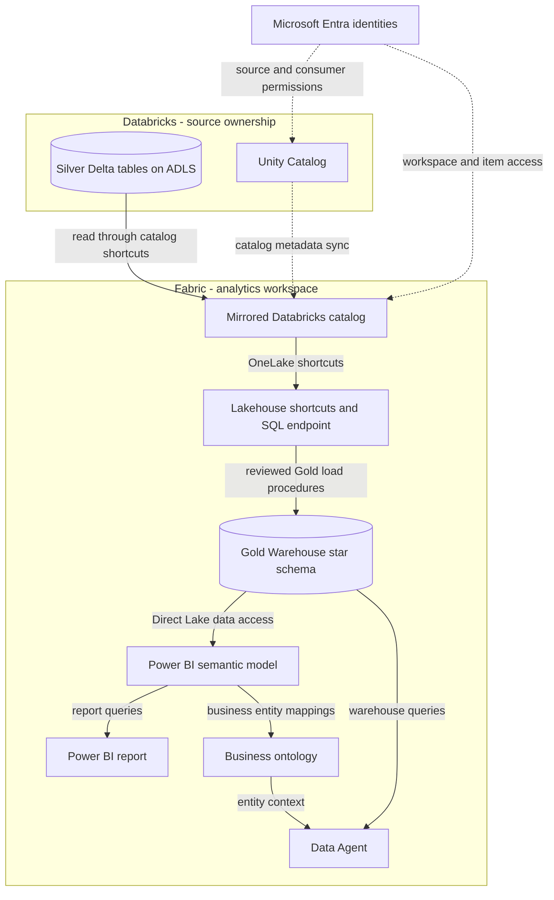

# FSI Fabric + Databricks Integration Demo

Explore three ways Azure Databricks and Microsoft Fabric can share data without copying it, and how that data feeds Fabric analytics, Power BI reports, and natural-language questions. Intended for data engineers, solution engineers, and demo presenters.

**Status: exported demo assets, not a one-click deployment.** Live connections, source data, upstream transformations, and tenant-specific bindings are not provided. 

## What you can demonstrate

This demo covers three integration patterns:

| # | Pattern | Where the data is stored | Direction |
|---|---|---|---|
| 1 | Azure Databricks with ADLS Gen2 storage, mirrored into Fabric | Your ADLS Gen2 account | Databricks → Fabric |
| 2 | OneLake catalog federation | OneLake (Fabric) | Fabric → Databricks |
| 3 | Azure Databricks using OneLake as storage through the Azure Databricks Storage item | OneLake (Fabric storage item) | Databricks writes to OneLake |

### 1. Azure Databricks with ADLS Gen2 as storage

Unity Catalog tables stored in ADLS Gen2 are surfaced in Fabric through a **Mirrored Azure Databricks catalog**, so no data is copied.

- Discover Databricks Unity Catalog tables in Fabric.
- Access the mirrored tables through Lakehouse shortcuts.
- Build a Gold warehouse star schema and consume it through a semantic model, report, ontology, and Data Agent.

  <!-- mermaid-checked: no \n, no em-dash/en-dash, no {} in labels, subgraphs are id["label"], arrows are -->|"label"|, all subgraphs closed by end, ids unique -->


### 2. OneLake catalog federation

Databricks reads Fabric OneLake data through Unity Catalog without copying it.

- Query Fabric lakehouse tables from Databricks as a federated catalog.
- Govern access to Fabric data through Unity Catalog.

### 3. Azure Databricks using OneLake as storage

A Unity Catalog external location points at an **Azure Databricks Storage item** in Fabric, and a catalog uses it as managed storage. Databricks keeps the compute and governance, while the table and volume files are stored in OneLake.

- Create Unity Catalog managed tables and volumes whose data is stored in OneLake.
- Restrict data access to the Databricks managed identity through OneLake security.
- Let Fabric users read the data through a mirrored Azure Databricks catalog.

> [!NOTE]
> The Azure Databricks Storage item is not yet supported by Fabric Git integration, so it isn't exported with the other Fabric items. See [azure-databricks-storage-item](azure-databricks-storage-item/README_AzureDatabricksStorage.md) for scripts and steps to recreate it. Parts of patterns 2 and 3 are in preview; check current Microsoft documentation before relying on them.

The included analytics assets use **CMS beneficiary and provider claims concepts**; they are a healthcare/insurance example. Data files and the upstream data preparation notebook are not included.

## Start here

| Your goal | Read this |
|---|---|
| Understand the design and data direction | [Architecture and diagrams](docs/architecture.md) |
| Set up the main demo | [Getting started](docs/getting-started.md) |
| Find an exported item or its dependencies | [Asset catalog](docs/asset-catalog.md) |
| Present the demo and check results | [Demo walkthrough](docs/demo-walkthrough.md) |
| Resolve a setup or data issue | [Troubleshooting](docs/troubleshooting.md) |
| Make a contribution | [Contributing](CONTRIBUTING.md) |

## Choose an integration path

| Path | Data owner and consumer | Repository coverage |
|---|---|---|
| [Mirrored Databricks catalog](docs/patterns/mirrored-catalog.md) | Databricks owns tables; Fabric reads them | Catalog items, shortcuts, warehouse, BI and agent exports |
| [OneLake catalog federation](docs/patterns/onelake-federation.md) | Fabric owns tables; Databricks reads them | Reference guidance; no connection or foreign-catalog deployment |

The Azure Databricks catalog item in Fabric is part of the mirrored-catalog
path, not a third independent integration pattern. Catalog mirroring
synchronizes metadata; shortcuts access the underlying data without replication.

## Quick start

1. Review the [prerequisites and setup gates](docs/getting-started.md).
2. Use an isolated Fabric demo workspace and an approved Databricks source.
3. Configure the mirrored catalog and verify the three required Silver tables.
4. Restore supported exports using Fabric Git integration, then rebind
   connections and downstream items through supported authoring tools.
5. Load the Gold star schema only after reviewing its rebuild behavior.
6. Run the [read-only validation queries](warehouse/validate-gold.sql), then
   follow the [report and agent walkthrough](docs/demo-walkthrough.md).

Follow the detailed guide before running cloud operations. Merely cloning this
repository or copying [.env.example](.env.example) does not configure resources.
No repository code loads that file.

## Repository map

| Location | Purpose |
|---|---|
| [docs](docs) | Architecture, setup, pattern guides, demo and troubleshooting |
| [ws_databricks](ws_databricks) | Service-managed Fabric item exports; preserve their hierarchy |
| [warehouse](warehouse/README.md) | Read-only validation examples; authoritative DDL stays in the exports |
| [notebooks](notebooks/README.md) | Upstream notebook requirements; no runnable notebook included |
| [scripts](scripts) | Dependency-free offline repository checks |
| [decisions](decisions) | Architecture decision template and future accepted decisions |

### Naming

`FSI` means financial services industry; `CMS` refers to Centers for Medicare
& Medicaid Services; `LH`, `WH`, and `SM` mean Lakehouse, Warehouse, and Semantic
Model.

## Validate locally

From the repository root in PowerShell:

```powershell
& .\scripts\Test-Repository.ps1
git diff --check
```

The checker validates local Markdown file targets and fence balance, JSON syntax,
and report-to-model relative paths. It does not render Mermaid, validate Fabric
schemas, execute SQL, scan for all secrets, or prove cloud connectivity.
See [validation guidance](docs/validation.md).

## Safety, cost and limitations

Use approved synthetic or public demo data, never customer or patient data.
Review exports for environment identifiers before publishing; placeholders do
not constitute a security certification. Keep credentials out of Git.

Fabric capacity, Databricks compute, storage and network traffic can incur
charges. Stop demo compute and remove only resources you own after the session.
This is not a production deployment blueprint: validate access controls,
networking, licensing, data quality and supportability in your tenant.
