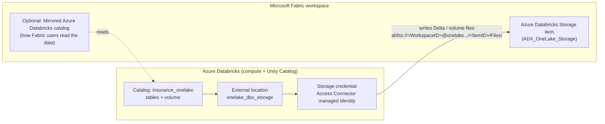

# Azure Databricks Storage item: OneLake as Unity Catalog managed storage

> [!WARNING]
> **Not yet supported in Fabric Git integration.**
> The Azure Databricks Storage item is not on the list of items supported by Fabric Git integration
> (checked November 2026). Committing the workspace from **Source control** will **not** add this
> item to the repo, and **Update all** will **not** recreate it in another workspace.
>
> This folder is the source-controlled replacement: scripts, SQL and step-by-step instructions to
> rebuild the item and its Databricks wiring in any workspace. Re-check the
> [supported items list](https://learn.microsoft.com/fabric/cicd/git-integration/intro-to-git-integration#supported-items)
> periodically; once the item is supported, keep this folder for the Databricks-side setup.

> [!IMPORTANT]
> **Preview status.** The Fabric REST API still labels the item *Preview*. On the Databricks side,
> OneLake external locations are *Public Preview* and must be enabled by a workspace admin on the
> **Previews** page. Check current documentation before relying on this in production.

*Personal learning project. Not official Microsoft guidance. All data is synthetic.*

---

## What this demo builds



Databricks keeps the compute and the Unity Catalog governance. The table and volume **files** are
physically stored in OneLake, inside the Fabric storage item.

## What is and isn't in source control

| Piece | Where it lives | In this repo? |
|---|---|---|
| Azure Databricks Storage item (Fabric) | Fabric workspace | **Recreated by** `scripts/01-create-storage-item.ps1` (not synced by Fabric Git) |
| Workspace role + OneLake security role | Fabric | `scripts/02-grant-access-connector.ps1` + manual Step 3b |
| Storage credential + external location | Unity Catalog | Steps 4-5 (UI) and `databricks/01-external-location.sql` |
| Catalog, schema, tables, volume | Unity Catalog | `databricks/02-create-demo-objects.sql` |
| Table and volume **data** | OneLake | **Never** in Git |
| Real IDs (workspace, item, subscription) | `config.local.json` | **Never** committed (git-ignored) |

## Folder layout

```text
azure-databricks-storage/
├── README.md                          this guide
├── config.example.json                copy to config.local.json and fill in
├── .gitignore                         keeps config.local.json out of Git
├── scripts/
│   ├── 01-create-storage-item.ps1     create/reuse the Fabric item, print the ABFSS path
│   ├── 02-grant-access-connector.ps1  Viewer role for the managed identity
│   └── 99-teardown.ps1                delete the Fabric item
└── databricks/
    ├── 01-external-location.sql       optional SQL route for Step 5
    ├── 02-create-demo-objects.sql     catalog, tables, volume, verification
    └── 03-teardown.sql                drop the demo objects
```

> [!TIP]
> Keep this folder **outside** the Git folder your Fabric workspace syncs to (for example
> `infra/azure-databricks-storage/` next to `fabric/`), so it never appears as unexpected content in
> Fabric's Source control pane.

---

## Prerequisites

| Area | Requirement |
|---|---|
| **Fabric tenant** | A Fabric admin enables **Users can create Azure Databricks Storage items** (Admin portal > Tenant settings) |
| **Fabric workspace** | Active Fabric capacity assigned. **Authenticate with OneLake user-delegated SAS tokens** enabled (Workspace settings > Delegated settings > OneLake settings). A **dedicated** workspace is recommended |
| **Azure** | An **Access Connector for Azure Databricks** with a managed identity (or an approved service principal) |
| **Databricks** | Unity Catalog-enabled workspace. **External location support for OneLake** enabled on the Previews page. Serverless compute or Databricks Runtime **18.1+** |
| **Databricks privileges** | `CREATE STORAGE CREDENTIAL` on the metastore; `CREATE EXTERNAL LOCATION` on the metastore **and** the credential |
| **Your machine** | PowerShell 7+, Azure CLI (`az login`) |

## Security model (read before you start)

- OneLake security is **on by default** and the item is **locked**: Fabric workspace roles
  (Admin, Member, Contributor, Viewer) do **not** grant access to its data.
- Only members of the item's **OneLake security role** can read or write it.
- Add **only** the access connector's managed identity (or your service principal) to that role.
  Anyone in the role can read and write the files directly, **outside Unity Catalog governance**.
- Fabric users should read the data through a **Mirrored Azure Databricks catalog** (Step 8),
  not through the storage item.

---

## Step 0 - Configure

```powershell
cd infra\azure-databricks-storage
Copy-Item config.example.json config.local.json
notepad config.local.json
```

Fill in the workspace name, item name and the access connector's resource ID
(Azure portal > Access Connector > Properties > Resource ID).

## Step 1 - Fabric settings (manual, one time)

1. **Admin portal > Tenant settings** > enable **Users can create Azure Databricks Storage items**.
2. **Workspace settings > Delegated settings > OneLake settings** > turn on
   **Authenticate with OneLake user-delegated SAS tokens** > **Confirm**.

## Step 2 - Create the storage item

```powershell
az login
.\scripts\01-create-storage-item.ps1
```

The script finds the workspace, creates the item (or reuses it if it already exists), and prints:

```text
abfss://<WorkspaceID>@onelake.dfs.fabric.microsoft.com/<StorageItemID>/Files/
```

It saves the IDs to `config.local.json` only.

*Portal alternative:* in the workspace, **New item > Azure Databricks Storage**, then copy the
workspace ID and item ID from the browser URL.

> The external location **must** use this ID-based path. Paths with display names are rejected.

## Step 3 - Grant access

**3a. Workspace role (script)**

```powershell
.\scripts\02-grant-access-connector.ps1
```

Gives the access connector's managed identity the **Viewer** role on the workspace.
Needs workspace **Admin**. For a user-assigned identity, set `accessConnectorPrincipalId` in
`config.local.json` first.

**3b. OneLake security role (manual)**

1. Open the storage item > **Manage OneLake security**.
2. **New role** > permission **ReadWrite**.
3. Add the managed identity as the **only** member > **Save**.

## Step 4 - Create the Unity Catalog storage credential (Databricks UI)

1. Databricks > **Catalog** > **+** > **Create a credential**.
2. Credential type: **Azure Managed Identity**. Name: `onelake_cred`.
3. **Access Connector ID**: the resource ID
   `/subscriptions/<subscription-id>/resourceGroups/<resource-group>/providers/Microsoft.Databricks/accessConnectors/<connector-name>`.
   For a user-assigned identity, also enter its **Managed Identity ID**.
4. **Create**.

## Step 5 - Create the OneLake external location

1. **Catalog** > **+** > **Create an external location**.
2. Name: `onelake_dbx_storage`. **Storage type: OneLake**.
3. **Storage credential**: `onelake_cred`.
4. **URL**: the ABFSS path from Step 2 > **Create**.
5. Click **Test connection**.
   A *"skipped file events read"* warning is **expected**: OneLake paths don't support file event
   notifications. The location still works.

*SQL alternative:* `databricks/01-external-location.sql`.

## Step 6 - Create the demo catalog, tables and volume

Open `databricks/02-create-demo-objects.sql` in a Databricks SQL editor or notebook, replace
`<ABFSS_PATH>`, and run it. It creates:

- Catalog `insurance_onelake` with the OneLake path as **managed location**
- Schema `claims` with tables `policies` and `claims` (synthetic rows)
- Managed volume `insurance` for unstructured files

`DESCRIBE DETAIL` at the end should show a location starting with
`abfss://<WorkspaceID>@onelake.dfs.fabric.microsoft.com/...`.

## Step 7 - Verify in Fabric

Open the storage item in Fabric. In **Explorer** you should see Unity Catalog's managed-storage layout:

```text
ADX_OneLake_Storage
└── Files
    └── __unitystorage
        └── catalogs
            └── <catalog-id>
                ├── tables       <- Delta files for policies / claims
                └── volumes
                    └── <volume-id>
                        └── insurance
```

The folder names are Unity Catalog GUIDs, not table names. That's expected. Don't rename, move or
edit anything here; Unity Catalog owns these files.

## Step 8 (optional) - Let Fabric users read the data

Create a **Mirrored Azure Databricks catalog** item that points at `insurance_onelake`.
That item **is** supported by Fabric Git integration and will sync with the rest of the workspace.

> If Fabric **Spark** (notebooks, Spark job definitions) must read these tables through the mirrored
> catalog, turn off catalog commits on those tables (commented lines at the end of
> `02-create-demo-objects.sql`). This also turns off the features that depend on catalog commits.
> The SQL analytics endpoint and Power BI aren't affected.

---

## Rebuild in a new workspace (checklist)

- [ ] Tenant setting enabled (Step 1)
- [ ] Workspace SAS-token setting on (Step 1)
- [ ] `config.local.json` points at the new workspace (Step 0)
- [ ] `01-create-storage-item.ps1` run, and new ABFSS path noted (Step 2)
- [ ] `02-grant-access-connector.ps1` run, and OneLake security role created (Step 3)
- [ ] External location created with the **new** path; reuse the existing credential (Steps 4-5)
- [ ] Catalog created on the new location (Step 6)

## Teardown

```powershell
# 1. In Databricks, run databricks/03-teardown.sql
# 2. Then delete the Fabric item (asks for confirmation):
.\scripts\99-teardown.ps1
```

> [!CAUTION]
> Deleting the storage item permanently deletes all Unity Catalog data stored in it.

## Troubleshooting

| Symptom | Check |
|---|---|
| **403 Forbidden** on the OneLake path | Managed identity has **Viewer** on the workspace; it's a member of a **ReadWrite** OneLake security role on the item; the workspace has an **active capacity** |
| Storage credential creation or test fails | Resource ID is correct; identity roles as above; path is the **ID-based** `.../<StorageItemID>/Files/` format |
| *Skipped file events read* warning | Expected. OneLake doesn't support file event notifications |
| Path rejected when creating the external location | Using display names instead of GUIDs; rerun Step 2 and copy the printed path |
| "Azure Databricks Storage" missing from **New item** | Tenant setting not enabled, or workspace not on Fabric capacity |
| Item not shown in Fabric **Source control** after commit | Expected. See the warning at the top of this file |
| Fabric Spark can't read a table via the mirrored catalog | Catalog commits are on; see Step 8 note |

## Known limitations

- Not supported in Fabric Git integration (top of this file).
- Fabric Spark can't read tables with **catalog commits** through a mirrored Azure Databricks catalog.
- **Databricks-to-Open** Delta Sharing isn't supported for managed tables stored on OneLake.
- Fabric doesn't show **FILE** columns from mirrored Azure Databricks catalogs.

## References

- Databricks: [Connect Azure Databricks to a OneLake external location](https://learn.microsoft.com/azure/databricks/connect/unity-catalog/cloud-storage/external-locations-onelake)
- Fabric REST API: [Create Azure Databricks Storage](https://learn.microsoft.com/rest/api/fabric/azuredatabricksstorage/items/create-azure-databricks-storage)
- Fabric REST API: [Azure Databricks Storage item definition](https://learn.microsoft.com/rest/api/fabric/articles/item-management/definitions/azure-databricks-storage-definition)
- Fabric: [Git integration supported items](https://learn.microsoft.com/fabric/cicd/git-integration/intro-to-git-integration#supported-items)
- Fabric blog: [Use OneLake as native storage for Azure Databricks](https://community.fabric.microsoft.com/blog/fbc_fabricupdatesblogs/use-onelake-as-native-storage-for-azure-databricks-generally-available/5377939)
