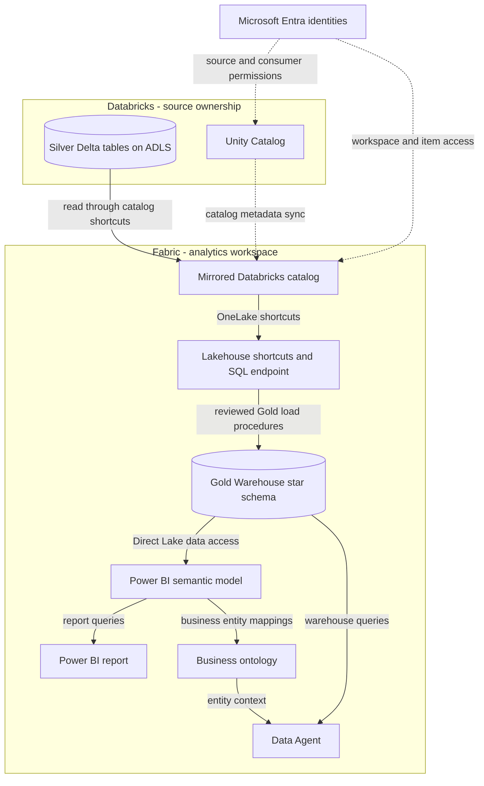

# Fabric + Azure Databricks Architecture

[Home](../README.md) | [Setup](getting-started.md) | [Asset catalog](asset-catalog.md)

This repository contains Fabric exports for a Databricks-to-Fabric demo and
reference guidance for the reverse direction. An exported relationship is not
evidence of a working connection: identifiers require rebinding and live
execution remains environment-dependent.

## Application architecture

Solid arrows show data made available to a consumer or transformed into a
destination. Dashed arrows show catalog metadata or identity configuration.
They do not represent automatic deployment. Only the Gold load materializes
new data in the main path; catalog mirroring and shortcuts do not replicate it.

```<!-- mermaid-checked: no \n, no em-dash/en-dash, no {} in labels, subgraphs are id["label"], arrows are -->|"label"|, all subgraphs closed by end, ids unique -->


### Technology stack summary

| Layer | Technology | Version | Purpose |
|---|---|---|---|
| Source governance | Azure Databricks Unity Catalog | Tenant-dependent | Own and expose supported Delta tables |
| Source storage | ADLS Gen2 and Delta | Check supported table features | Retain source data ownership |
| Fabric access | Mirrored catalog and OneLake shortcuts | Managed service | Read source data without replication |
| Transformation | Fabric Warehouse T-SQL | Managed service | Materialize Gold dimensions and facts |
| BI | Power BI semantic model and report | Managed service | Measures, relationships and visualization |
| Business context | Fabric Ontology and Data Agent | Check availability in tenant | Entity mappings and natural-language queries |

### Data storage and external services

The primary path reads Databricks-owned data in place. Gold warehouse loading
is a separate transformation with storage and compute costs, not part of
mirroring. No upstream source files or Databricks transformation notebook are
included. The optional Eventstream export is not required by the core path.

### Key architectural decisions

- Preserve Fabric-managed item folders and rebind through supported tools.
- Keep mirroring, physical transformation and semantic modeling distinct.
- Treat provider claims and beneficiary annual summaries as different grains;
  their totals and supported filters are not interchangeable.

These are documentation principles, not accepted ADRs. Record future decisions
with the [ADR template](../decisions/adr-template.md).

## Component relationships

This view traces the CMS path represented by the exports. Solid arrows denote
data dependencies; dashed arrows denote configuration/context. It is not a
claim that the source tables are populated or the exported bindings are usable.

```mermaid
flowchart LR
    subgraph AccessComponents["Catalog and Lakehouse"]
        cMirror["ADX_Mirror_CMS_Data"]
        cLake["LH_ADX_Mirror"]
    end
    subgraph TransformComponents["Warehouse"]
        cSilver["Silver SQL tables"]
        cLoad["gold.usp_load_gold_dim_fact"]
        cGold["WH_ADX_CMS_Gold dimensions and facts"]
    end
    subgraph ExperienceComponents["Analytics and AI"]
        cBefore["SM_ADX_Gold_CMS_Before"]
        cAfter["SM_ADX_Gold_CMS_After"]
        cReport["RPT_ADX_Gold_CMS_Overview"]
        cOntology["Ontology_ADX_Gold_CMS"]
        cAgent["DA_ADX_Gold_CMS"]
    end
    cMirror -->|"bronze and silver shortcuts"| cLake
    cLake -->|"SQL endpoint visibility"| cSilver
    cSilver -->|"cross-database source reads"| cLoad
    cLoad -->|"full rebuild and validation"| cGold
    cGold -->|"SQL endpoint binding"| cBefore
    cGold -->|"Direct Lake binding"| cAfter
    cAfter -->|"relative report reference"| cReport
    cAfter -->|"semantic entity mappings"| cOntology
    cGold -->|"warehouse data source"| cAgent
    cOntology -.->|"configured entity context"| cAgent
```

<!-- mermaid-checked: no \n, no em-dash/en-dash, no {} in labels, subgraphs are id["label"], arrows are -->|"label"|, all subgraphs closed by end, ids unique -->


### Component inventory

| Component | Layer | Type | Responsibility |
|---|---|---|---|
| ADX_Mirror_CMS_Data | Access | Mirrored catalog | Surface selected Unity Catalog tables |
| LH_ADX_Mirror | Access | Lakehouse | Expose bronze/silver shortcuts |
| gold.usp_load_gold_dim_fact | Transformation | Stored procedure | Rebuild six dimensions and three facts from Silver |
| WH_ADX_CMS_Gold | Storage | Warehouse | Persist the Gold star schema |
| SM_ADX_Gold_CMS_Before | Analytics | Semantic model | Technical table naming and SQL endpoint expression |
| SM_ADX_Gold_CMS_After | Analytics | Semantic model | Business names, measures and Direct Lake expression |
| RPT_ADX_Gold_CMS_Overview | Presentation | Report | Reference the After semantic model |
| Ontology_ADX_Gold_CMS | Context | Ontology | Map business entities to the After model |
| DA_ADX_Gold_CMS | AI | Data Agent | Query Gold with configured warehouse and ontology context |

See the [asset catalog](asset-catalog.md) for all exports, including the
separate insurance catalog and Lakehouse.

## Reverse direction: OneLake catalog federation

[OneLake federation](patterns/onelake-federation.md) lets Databricks query
Fabric-owned Lakehouse or Warehouse data read-only, without copying it.
Unity Catalog contains the foreign catalog; OneLake remains the data store.
This is not a Fabric-side federation node feeding the Gold warehouse.

The repository does not include federation connections, storage credentials,
or foreign-catalog deployment artifacts. Do not infer this path from an item
whose name contains `onelake`: both exported catalog items have the
`MirroredAzureDatabricksCatalog` type.

## Status and validation

| Capability | Evidence | Status |
|---|---|---|
| Catalog and shortcut wiring | Exported item definitions | Represented; live rebinding required |
| Silver-to-Gold transformation | Warehouse DDL and procedures | Included; source preparation missing |
| Report, model, ontology and agent | Exported definitions | Included; live queries unverified |
| OneLake federation | Official reference guide | Documented alternative only |
| Cloud end-to-end behavior | Requires tenant execution | Not established by local checks |

## References

Terminology reviewed against these references on 2026-11-09. Recheck current
feature availability, identity support and networking requirements before use.

- [Mirrored Databricks catalogs](https://learn.microsoft.com/en-us/fabric/mirroring/azure-databricks)
- [Mirroring setup and Lakehouse shortcuts](https://learn.microsoft.com/en-us/fabric/mirroring/azure-databricks-tutorial)
- [Enable OneLake catalog federation](https://learn.microsoft.com/en-us/azure/databricks/query-federation/onelake)
