# Demo architecture

## Scope and evidence

This document describes an intended Microsoft Fabric + Azure Databricks demo.
The repository contains Fabric-exported definitions, not a verified deployment.
The inventory below is based on directory names; it does not establish that
connections, transformations, refreshes, or report bindings work.

## Intended logical flow

```mermaid
flowchart LR
    Source["Approved demo data"] --> DBX["Azure Databricks / Unity Catalog"]
    DBX -. "Configure and validate integration" .-> Fabric["Fabric mirrored catalogs / OneLake access"]
    Fabric -. "Validate downstream dependencies" .-> Stores["Fabric lakehouses / warehouse"]
    Stores -. "Validate model bindings and refresh" .-> Model["Semantic models"]
    Model -. "Validate report results" .-> Report["Power BI report"]
```

Dashed arrows represent intended relationships, not confirmed wiring. No data
movement or refresh strategy is selected by this scaffold. Confirm the supported
integration mode, table compatibility, access model, and data freshness before
implementing it, then record the choice in an [ADR](../decisions/adr-template.md).

## Existing repository groups

| Group under `ws_databricks` | Observed item types | Intended role; not validated |
| --- | --- | --- |
| [Azure Databricks Store](../ws_databricks/Azure%20Databricks%20Store/) | Mirrored Azure Databricks catalogs, eventstream | Source integration and event ingestion experiments |
| [Fabric Data Stores](../ws_databricks/Fabric%20Data%20Stores/) | Lakehouses, warehouse | Data access, storage, and serving |
| [Business Intelligence](../ws_databricks/Business%20Intelligence/) | Semantic models, report, ontology | Modeling and analytics consumption |
| [Agents](../ws_databricks/Agents/) | Data agent | Exploratory conversational access to configured data |

These are inventory labels, not guarantees that each item participates in the
same flow. Item names are preserved; their presence does not indicate deployment
or operational health.

## Prerequisites and boundaries

- Access to a Fabric workspace on an appropriate capacity, with required
  workloads enabled and permissions approved by its administrator.
- An Azure Databricks workspace with Unity Catalog and supported source tables.
  Validate the current integration's external-access requirements, permissions,
  networking constraints, and regional availability.
- Explicitly configured Fabric connections and downstream model/report bindings.
  Workspace exports are not a substitute for provisioning or credentials.
- Approved synthetic or de-identified data with known expected results.

Fabric item folders are service-managed export boundaries. This scaffold leaves
all existing items untouched. Authoring/importing items, provisioning Azure
resources, configuring identities, and setting up networking remain separate
tasks requiring explicit scope and validation.

## Configuration and identity

[`.env.example`](../.env.example) documents optional local identifiers for Azure,
Fabric, and Databricks. It is a convention for future tooling, not an executable
configuration contract: nothing currently reads these variables. Do not copy
secrets into it or assume it configures Fabric connections.

Use approved Microsoft Entra identities and least-privilege permissions. Treat
Databricks source access, Fabric connection access, workspace/item permissions,
and report-consumer permissions as distinct controls. Do not assume source
authorization automatically secures every downstream artifact. Use approved
secret management if a future integration requires credentials.

## Validation before presenting

1. Confirm which source tables and integration mode are in scope.
2. Verify source and Fabric access using the intended demo identity.
3. Inspect the configured connection and validate table visibility and freshness.
4. Check downstream lakehouse/warehouse dependencies and model bindings.
5. Refresh the semantic model where required and compare report outputs against
   known source counts and business totals.
6. Confirm consumers cannot access data beyond the approved demo scope.
7. Record results, limitations, and resource cleanup responsibilities.

No end-to-end execution, performance, cost, or security validation is included
in this documentation scaffold. Do not describe the demo as production-ready.

## References

- [Microsoft Fabric mirroring overview](https://learn.microsoft.com/fabric/mirroring/overview)
- [Configure a Fabric mirror from Azure Databricks Unity Catalog](https://learn.microsoft.com/fabric/mirroring/azure-databricks-tutorial)
- [Repository contribution guidance](../CONTRIBUTING.md)
